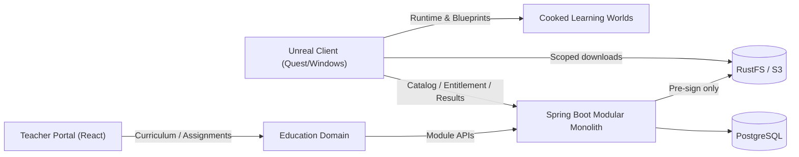

# VRTrainingAcademy — architecture R0

## Product boundaries

- **Platform Core** (Spring Boot / PostgreSQL / RustFS): organization and device identity, entitlements, catalog publication, signed content grants, delivery manifests, offline licenses, auditing.
- **Education Domain** (Java + React/TypeScript): curricula, country-specific mappings, classes, assignments, lessons, assessment and progress; owns pedagogical metadata. Other domains must not read its tables directly.
- **Unreal Experience Runtime** (UE C++ / Blueprints): Knowledge Hub, input abstraction, interaction and simulation components, offline content manager, local persistence.

Professional/Safety is a future bounded context, not a subdomain of Education. Shared media/world assets belong to Platform's content contracts; learning goals belong to the respective domain.

## Domain ownership

1. Platform: Tenant, DeviceActivation, CatalogWorld, ContentModule, ContentRelease, ContentArtifact, Entitlement, DownloadGrant.
2. Education: Curriculum, Subject, LearningObjective, Lesson, Classroom, Assignment, Assessment, LearningAttempt.
3. Unreal: installed releases registry and checksummed local cache, display and user interaction. Does not grant its own permissions.

## R0 / R1 contract

- R0: anonymous `GET /api/v1/public/catalog?locale=ru-RU` returns 3 free lessons from School/Astronomy, School/Physics, Professional/Safety. Read-only sample metadata; no download entitlement implied.
- R1: scoped authenticated catalog, distinct guest grants, platform-specific releases, RustFS pre-signed URLs, validation and verified offline reopen.
- R2: teacher workspace with scoped assignments, persistent PostgreSQL and Liquibase.
- R3: proof on **packaged Windows then physical Quest** of download → cryptographic verification → cook-compatible mount → launch → restart → offline reopen.

## Non-negotiable constraints

- Never use login alone as authentication. Teacher/device activation can grant short-lived bounded sessions; protect admin actions with OIDC.
- Tenant context must be derived from authenticated claims, never arbitrary client input.
- SHA-256 detects corruption but does **not** prove authenticity: verify signed release manifest against pinned trusted key.
- Quest and Windows assets must be cooked separately and match runtime/engine/build.
- `pak`/IoStore download-and-mount on Quest is **unproven**; isolate behind content installer interface and require device acceptance.
- Platform Core must not depend on Education. Education may use Platform's published APIs/contracts.
- Multilingual content must be reviewed before marked published; kk-KZ, ru-RU, en-US first.
- No claims of certified safety/medical training without expert validation.

## Test-first delivery

1. Catalog contract tests and baseline compilation.
2. Persisted models with tenant isolation tests (Testcontainers/PostgreSQL).
3. License and grant security RED tests.
4. RustFS integration and corrupt package resilience tests.
5. Windows packaged dynamic content acceptance.
6. Quest real-device acceptance, with offline replay and rollback.
